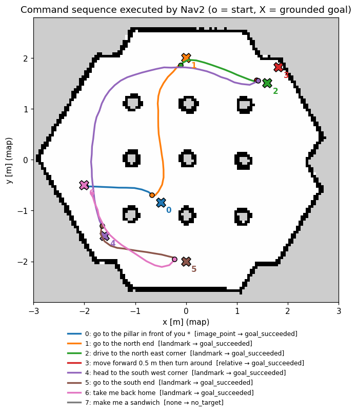
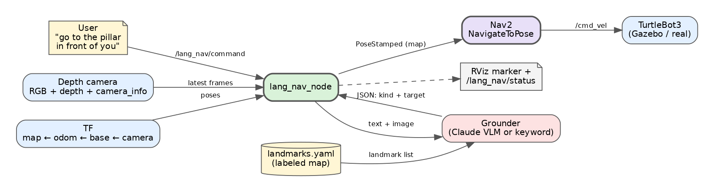
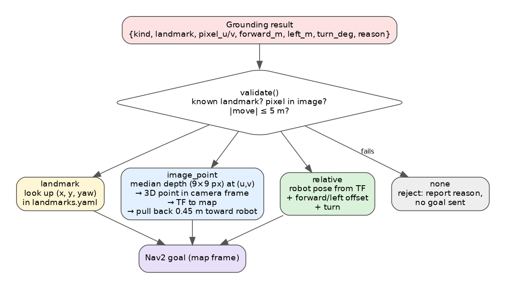
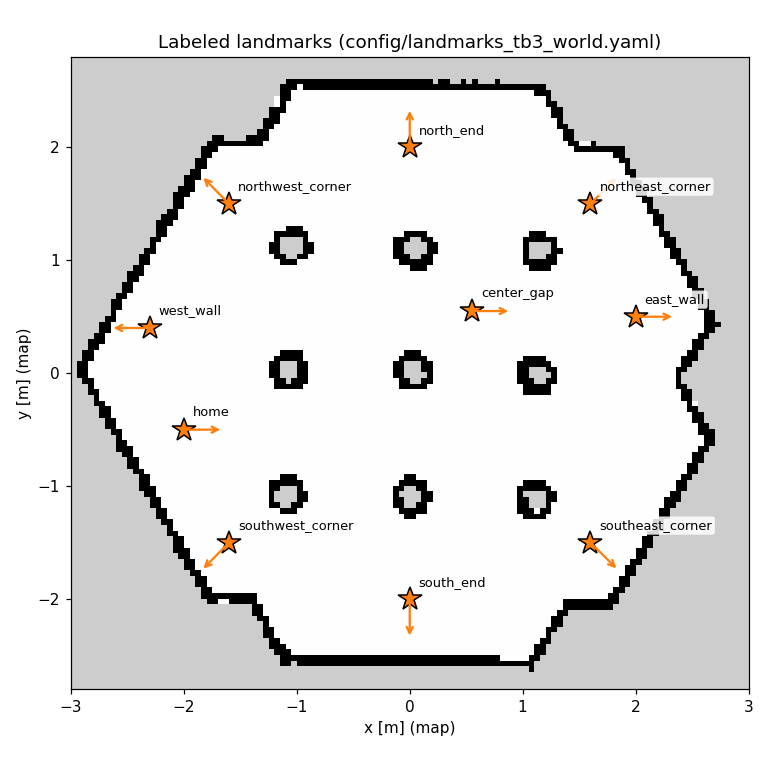
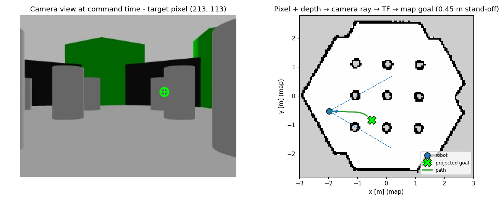
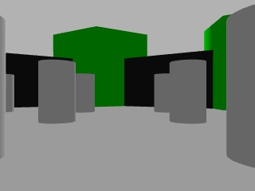

# lang_nav — Language-guided navigation with a VLM and Nav2

Tell a TurtleBot3 where to go in plain English. A vision-language model (Claude) looks at the
command, the robot's camera image and a list of labeled places, and returns a structured target.
The node turns that target into a map-frame pose and sends it to Nav2.

```
"go to the pillar in front of you"   →   pixel (213, 113) + depth 1.86 m   →   Nav2 goal (-0.50, -0.84)   →   🤖 drives there
```



*A scripted 8-command session in Gazebo (keyword backend). Every reachable goal was reached within
Nav2's 0.25 m tolerance. The last command ("make me a sandwich") was correctly rejected.*


> Part of my Physical AI project set: [rl_nav](https://github.com/Deivaprakash56/rl-navigation-vs-nav2) (RL navigation benchmarked against Nav2) · [il_arm](https://github.com/Deivaprakash56/imitation-learning-pick-and-place) (Imitation learning for pick-and-place).
> Everything here runs in simulation. The ROS 2 interfaces are the same ones a real robot uses.

## Quick start

Requirements: Ubuntu 22.04, ROS 2 Humble, Nav2 and Gazebo 11, Python 3.10.

```bash
git clone https://github.com/Deivaprakash56/-vlm-language-navigation-ros2.git ~/lang_nav && cd ~/lang_nav
python3 -m venv --system-site-packages .venv && touch .venv/COLCON_IGNORE
.venv/bin/pip install anthropic "numpy<2" matplotlib pyyaml

# TurtleBot3 Gazebo models (no sudo; or: sudo apt install ros-humble-turtlebot3-gazebo)
mkdir -p third_party/deb && (cd third_party/deb && apt-get download ros-humble-turtlebot3-gazebo \
    && dpkg -x ros-humble-turtlebot3-gazebo_*.deb ../tb3_gazebo) && touch third_party/COLCON_IGNORE

source /opt/ros/humble/setup.bash && colcon build --symlink-install
source env.sh                                   # in every new terminal
python -m pytest -q src/lang_nav/test
```


---

## Contents

1. [How it works](#1-how-it-works)
2. [The three kinds of target](#2-the-three-kinds-of-target)
3. [Results in Gazebo](#3-results-in-gazebo)
4. [Setup](#4-setup)
5. [Running it](#5-running-it)
6. [Parameters and interfaces](#6-parameters-and-interfaces)
7. [Code map](#7-code-map)
8. [Troubleshooting](#8-troubleshooting)
9. [Limitations and next steps](#9-limitations-and-next-steps)

---

## 1. How it works



1. A text command arrives on `/lang_nav/command` (`std_msgs/String`).
2. The node grabs the latest RGB frame. If it is under 2 s old, the frame goes to the grounder
   with the command and the landmark list.
3. The **grounder** returns one JSON object with a fixed schema:
   ```json
   {"kind": "image_point", "landmark": "", "pixel_u": 213, "pixel_v": 113,
    "forward_m": 0, "left_m": 0, "turn_deg": 0, "reason": "pillar centred in view"}
   ```
4. `validate()` rejects anything unusable: an unknown landmark name, a pixel outside the image,
   or a relative move longer than 5 m.
5. The target becomes a `PoseStamped` in the `map` frame (see §2) and goes to Nav2's
   `navigate_to_pose` action. A new command cancels the previous goal, and `stop` cancels outright.
6. Each step is published as a JSON event on `/lang_nav/status`. The goal is also published as
   an arrow marker on `/lang_nav/goal_marker`.

Grounding runs in a worker thread, so the ROS executor keeps processing camera frames and action
feedback while the model is thinking.

### Two grounding backends

| Backend | When to use | How it decides |
|---|---|---|
| `claude` (default) | real use | Claude `claude-opus-5-5`, image + text, **structured output** (JSON schema enforced by the API), `effort: low` for interactive latency, server-side refusal fallback enabled |
| `keyword` | tests, no API key, CI | token overlap with landmark names/descriptions + regexes for "forward 1 m", "turn left 90" |

The keyword backend is deliberately simple. "take me to the middle" fails with it because the
word "middle" appears in no landmark. Covering cases like that is what the VLM is for.

---

## 2. The three kinds of target



### `landmark` — named places on the map

Places live in [`config/landmarks_tb3_world.yaml`](src/lang_nav/config/landmarks_tb3_world.yaml) as `name`,
`description`, `x`, `y`, `yaw`. The model receives the names and descriptions, so a description
like *"Far north end of the arena, past the top row of pillars"* lets it resolve "the top of the
map" or "past the pillars".



To label a new map, open it in RViz, use **Publish Point** on each spot, and copy the
coordinates into a YAML file. Point the node at it with `-p landmarks_file:=/path/to/file.yaml`.

### `image_point` — "that thing I can see"

The model returns a pixel `(u, v)`. The node turns it into a map pose:

```
z      = median of valid depth values in a 9×9 window around (u, v)      (robust to edge pixels)
X_cam  = ((u - cx)·z / fx,  (v - cy)·z / fy,  z)                       (optical frame: x right, y down, z fwd)
X_map  = TF(map ← camera_depth_frame) · X_cam
goal   = X_map pulled 0.45 m back toward the robot, facing X_map         (don't drive into the object)
```



*Left: the camera frame when the command was issued, with the target pixel (213, 113). Right:
the depth (1.86 m) back-projected through TF lands at (-0.06, -0.94) on the map. That is 0.17 m
from the centre of the pillar at (0, -1.1), i.e. on its surface. The goal is the green X, 0.45 m
short of the pillar.*

The prompt asks the model for a pixel *at the base of* the target. On the floor right in front
of an object, the depth lookup lands on a reachable spot instead of a far wall seen past the
object's edge.

### `relative` — "go forward 1 m", "turn around"

The node reads the robot pose from TF (`map → base_footprint`) and adds the offset in the robot's
own frame: `forward_m` along the heading, `left_m` to the left, `turn_deg` counter-clockwise.

### `none` — refuse

Ambiguous, unsafe or impossible requests get `kind: none` with a one-line reason. No goal is
sent, and the reason appears on `/lang_nav/status`.

---

## 3. Results in Gazebo

`scripts/run_lang_nav_demo.sh keyword` produced these. It starts the simulation, runs the
command list in [`lang_nav/demo_eval.py`](src/lang_nav/lang_nav/demo_eval.py), records everything and draws
the figures.

| # | Command | Grounded as | Target | Nav2 result | Final error (m) | Time (s) |
|---|---|---|---|---|---|---|
| 0 | go to the pillar in front of you * | image_point | pixel (213, 113) | succeeded | 0.23 | 7.5 |
| 1 | go to the north end | landmark | north_end | succeeded | 0.20 | 15.5 |
| 2 | drive to the north east corner | landmark | northeast_corner | succeeded | 0.22 | 11.1 |
| 3 | move forward 0.5 m then turn around | relative | relative move | succeeded | **0.48** | 5.5 |
| 4 | head to the south west corner | landmark | southwest_corner | succeeded | 0.20 | 27.8 |
| 5 | go to the south end | landmark | south_end | succeeded | 0.24 | 11.7 |
| 6 | take me back home | landmark | home | succeeded | 0.22 | 15.9 |
| 7 | make me a sandwich | none | *no landmark or motion keyword matched* | rejected | – | 0.7 |

\* No API key was configured during this run. A stand-in played the VLM's part for the visual
command: it took the obstacle nearest the image centre in the depth image and sent `@pixel u v`.
Everything after the pixel (depth, TF, stand-off, Nav2) is the real pipeline.

**Reading the table**

- *Final error* is the distance between where the robot stopped and the goal that was sent.
  0.20–0.24 m matches Nav2's default `xy_goal_tolerance` of 0.25 m.
- Row 3 is a real finding. Moving 0.5 m forward from the north-east corner targets a point inside
  the wall's inflation zone. Nav2's planner (tolerance 0.5 m) substituted the nearest free cell,
  so the robot only turned in place. Nav2 still reported **success**, but the requested point
  was 0.48 m away. A production version should check the goal against the global costmap before
  sending it, and report "can't go there" instead.
- *Time* is end-to-end, from command to Nav2 result. With the keyword backend, grounding takes
  about 0 s. With Claude, add the model latency, which is logged as `latency_s` in the
  `grounded` status event.

The camera view at the visual command:



---

## 4. Setup

From the repository root:

```bash
# one-time: Python deps in the project venv (numpy<2 keeps cv_bridge working)
.venv/bin/pip install anthropic "numpy<2"

# one-time: TurtleBot3 Gazebo models (no sudo; extracted from the official .deb)
mkdir -p third_party/deb && cd third_party/deb
apt-get download ros-humble-turtlebot3-gazebo && dpkg -x ros-humble-turtlebot3-gazebo_*.deb ../tb3_gazebo
cd ../.. && touch third_party/COLCON_IGNORE
# (or, with sudo: sudo apt install ros-humble-turtlebot3-gazebo)

source /opt/ros/humble/setup.bash && colcon build --symlink-install
source env.sh            # in every new terminal: ROS + workspace + venv + Gazebo model paths
```

For the Claude backend, set credentials with either of:

```bash
export ANTHROPIC_API_KEY=sk-ant-...      # or:  ant auth login
```

---

## 5. Running it

### Interactive

```bash
# terminal 1: Gazebo (headless) + Nav2 + RViz + lang_nav
ros2 launch lang_nav lang_nav_sim.launch.py                       # Claude
ros2 launch lang_nav lang_nav_sim.launch.py backend:=keyword      # no API key
ros2 launch lang_nav lang_nav_sim.launch.py headless:=False       # show the Gazebo window

# terminal 2: type commands
ros2 run lang_nav lang_nav_cli
> go to the north east corner
  <- {"command": "go to the north east corner", "has_image": true, "event": "grounding"}
  <- {"command": "...", "kind": "landmark", "landmark": "northeast_corner", ..., "event": "grounded"}
  <- {"command": "...", "x": 1.6, "y": 1.5, "event": "goal_sent"}
  <- {"command": "...", "event": "goal_succeeded"}
> stop
```

You can also publish directly:

```bash
ros2 topic pub --once /lang_nav/command std_msgs/String "data: 'turn left 90 degrees'"
ros2 topic echo /lang_nav/status
```

### Without ROS (prompt testing)

```bash
ros2 run lang_nav lang_nav_cli --offline "go somewhere near the top right" --backend claude
ros2 run lang_nav lang_nav_cli --offline "go to the box" --image frame.jpg --backend claude
```

### Reproduce the results above

```bash
scripts/run_lang_nav_demo.sh keyword    # -> docs/lang_nav/run1/
scripts/run_lang_nav_demo.sh claude     # -> docs/lang_nav/run_claude/  (the visual command is real text)
```

### Tests

```bash
python3 -m pytest -q src/lang_nav/test      # 9 tests: keyword grounding, validation, debug pixel
```

---

## 6. Parameters and interfaces

| Parameter | Default | Meaning |
|---|---|---|
| `backend` | `claude` | `claude` or `keyword` |
| `model` | `claude-opus-5-5` | Claude model ID |
| `effort` | `low` | `low` / `medium` / `high`; higher = slower, more careful |
| `landmarks_file` | `config/landmarks_tb3_world.yaml` | labeled places |
| `use_camera` | `true` | send the camera image to the model |
| `rgb_topic` | `/intel_realsense_r200_depth/image_raw` | |
| `depth_topic` | `/intel_realsense_r200_depth/depth/image_raw` | must be pixel-aligned with RGB |
| `camera_info_topic` | `/intel_realsense_r200_depth/camera_info` | intrinsics for back-projection |
| `depth_scale` | `1.0` | `0.001` for 16-bit millimetre depth (real RealSense) |
| `global_frame` / `robot_frame` | `map` / `base_footprint` | |
| `standoff_m` | `0.45` | stop this far short of image targets |
| `max_image_age_s` | `2.0` | older frames are not sent |

| Interface | Type | Direction |
|---|---|---|
| `/lang_nav/command` | `std_msgs/String` | in — `"stop"`/`"cancel"` cancels the current goal |
| `/lang_nav/status` | `std_msgs/String` (JSON) | out — `grounding`, `grounded`, `projected`, `goal_sent`, `goal_succeeded`/`aborted`/`canceled`, `rejected`, `error` |
| `/lang_nav/goal_marker` | `visualization_msgs/Marker` | out — arrow at the goal |
| `navigate_to_pose` | `nav2_msgs/NavigateToPose` | action client |

---

## 7. Code map

```
lang_nav/
├── lang_nav/
│   ├── grounding.py         # Landmark map, GroundingResult + validate(), KeywordGrounder, ClaudeGrounder (no ROS)
│   ├── lang_nav_node.py     # ROS node: subscriptions, worker thread, pixel→map projection, Nav2 client
│   ├── cli.py               # interactive publisher / offline grounding
│   ├── set_initial_pose.py  # publishes /initialpose until AMCL answers (replaces RViz "2D Pose Estimate")
│   ├── demo_eval.py         # scripted evaluation run → run.json + camera frames
│   └── plot_demo.py         # figures + results table from run.json
├── config/landmarks_tb3_world.yaml
├── launch/lang_nav_sim.launch.py   # nav2_bringup tb3 sim + initial pose + node
├── docs/                    # figures used in this README
└── test/test_grounding.py
```

---

## 8. Troubleshooting

Each of these came up while building the project:

| Symptom | Cause | Fix |
|---|---|---|
| `spawn_entity: Service /spawn_entity unavailable` and no robot | `world_only.model` needs `model://turtlebot3_world`; without `turtlebot3_gazebo` installed, gzserver hangs trying the retired online model database | install or extract the models (§4); `env.sh` and the launch file set `GAZEBO_MODEL_DATABASE_URI=""` |
| Nav2 never becomes active, `map` frame missing | AMCL waits for an initial pose (normally clicked in RViz) | the launch file runs `set_initial_pose` automatically |
| `gzserver ... exit code 255` on relaunch | an old gzserver is still running, or another workspace's Gazebo holds port 11345 | `scripts/kill_sim.sh` stops only this workspace's sims; the scripts use their own ROS domain (77) and Gazebo port (11377) |
| Nav2 container starts but never loads nodes | a stale `nav2_container` from the previous run took the load requests | `scripts/kill_sim.sh` |
| `cv_bridge` import errors about NumPy | NumPy 2 in the venv | `pip install "numpy<2"` |
| "take me back home" moved the robot backward | early keyword-regex bug ("back" read as a motion) | fixed: "back" only counts as a motion when a distance follows; regression test added |

---

## 9. Limitations and next steps

- **Measure the Claude backend.** Run `scripts/run_lang_nav_demo.sh claude` with a larger command
  set, about 30 commands: 10 landmark, 10 visual, 10 relative or ambiguous. Report grounding
  accuracy per kind, end-to-end success and median latency at `effort: low` vs `medium`.
- **Check goals against the costmap** before sending them (the row 3 case), and reply
  "that spot is blocked" instead of letting Nav2 silently substitute one.
- **Multi-step commands** ("go to the north end, then come back"): have the model return a list
  of targets and execute them as a Nav2 `NavigateThroughPoses` request.
- **Open-vocabulary map labels**: instead of a hand-written YAML, capture images while exploring
  and let the model name places automatically.
- **Real robot**: set `depth_scale:=0.001` and the RealSense topics. Keep `standoff_m` ≥ 0.4.
